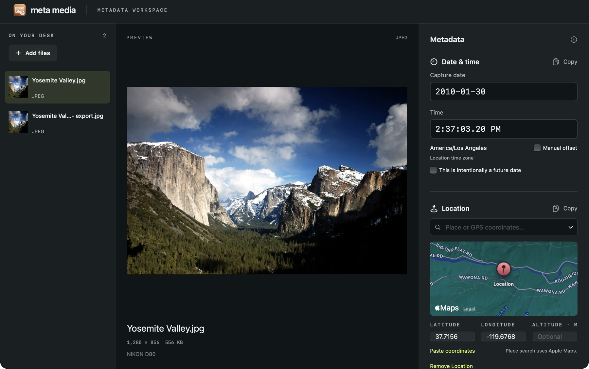
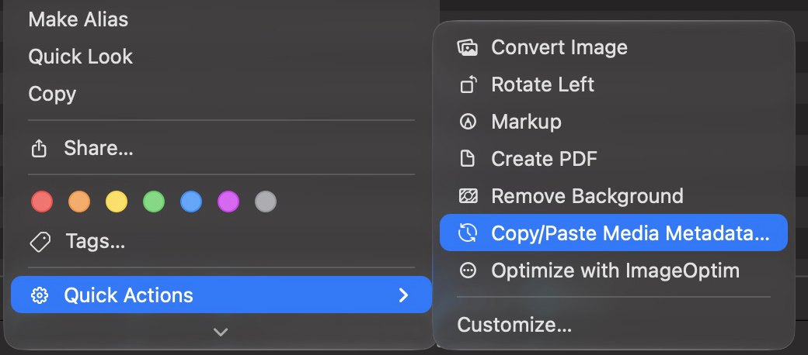

# Meta Media

Meta Media lets you copy, paste, and edit dates, times, and GPS locations in photos and videos on your Mac.

Inspired by the easy metadata copying in iOS Photos, it brings that convenience to files in Finder—especially when compression or conversion strips away their original details.

## Two ways to use Meta Media

### 1. In the app

Drop files into Meta Media or choose **Add files**. Edit date, time, and location directly in the inspector. Valid edits save automatically, with **Undo** available for each field during the current session.

The inspector shows a labeled Finder date when capture metadata is missing. Add GPS by searching for a place, pasting coordinates, or selecting a recent or saved location.

To apply the same date/time or location to several files, copy it from one file, select the targets, and right-click a selected row to paste. Shift-click selects a range. Command-click or Control-click toggles individual rows. Delete removes selected files from the desk list.

### 2. From Finder Quick Actions

For quick copy and paste while browsing files, open Meta Media once and choose **Meta Media → Install Finder Quick Action…**. Then right-click a file in Finder and choose **Quick Actions → Copy/Paste Media Metadata…**.

Copy available metadata from one source, then run the action on your target files and choose which fields to paste. If the source has no capture date, the action uses its Finder Created and Modified dates. If the action is missing, enable it under **Quick Actions → Customize…**. Reinstall the action if you move or rename the app.

Both workflows edit the original file. Finder Quick Action changes are outside the app’s Undo history.

## Install

Requires an Apple silicon Mac (M1 or newer) and macOS 14 Sonoma or later. Meta Media is free and requires no account.

1. [Download the ZIP from Releases](https://github.com/stevenchu/meta-media/releases/latest) and unzip it.
2. Move **Meta Media.app** into Applications or your own Applications folder.
3. Open Meta Media.

This preview is ad-hoc signed and has no Apple notarization. macOS may block the first launch, and some managed Macs may prohibit it. See [Apple’s guidance for opening downloaded apps](https://support.apple.com/102445).

## Supported formats

| Format | Metadata editing |
| --- | --- |
| JPEG, PNG, HEIC/HEIF, WebP | Read and write |
| MP4, MOV | Read and write |
| DNG | Read/copy only |
| Other formats | Not guaranteed; the app identifies read-only files |

Time is displayed in AM/PM. Capture-date edits synchronize Finder Created and Modified. Without GPS, time uses your device zone; with GPS, it uses the location's zone when available. If zone lookup fails, the app shows its fallback. Manual offset is available for ambiguous times.

## Updates

Choose **Meta Media → Check for Updates…**. Sparkle verifies signed update archives and handles download, installation, and relaunch. Automatic checks are optional. Updates may require authorization if the installation folder isn't writable.

End users never need the developer's private update-signing key. A Keychain prompt mentioning “Private key for signing Sparkle updates” belongs to the developer's release tools, not normal app use.

## Privacy

Media editing happens locally; the app does not upload your photos or videos. Apple Maps search, map display, and time-zone lookup use Apple services. Update checks contact the release host. Saved locations stay on your Mac. Dependency license notices ship inside the app.

## Known limitations

- Apple silicon only; Intel builds are not included.
- First-install/quarantine behavior still needs validation on another Mac.
- Batch writes are verified per file, not one transaction for the whole batch.
- Finder edits made to a file already open in Meta Media require reimporting that file.
- Saved locations and undo are separate: changing a saved place does not retag existing files.

For a bug report, include macOS/app version, file format, steps, and the error text. Avoid uploading private media or exact GPS coordinates; use a non-sensitive sample if one is needed.

Screenshot photo: [Tunnel view, Yosemite by Ted Wakabayashi (public domain)](https://commons.wikimedia.org/wiki/File:Tunnel_view,_Yosemite.jpg).
